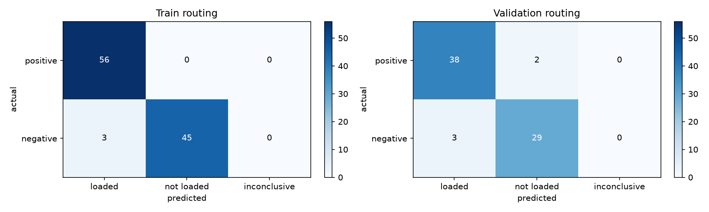
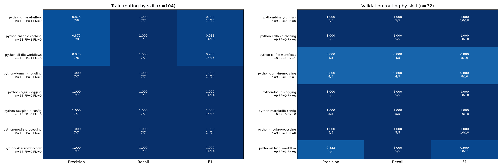
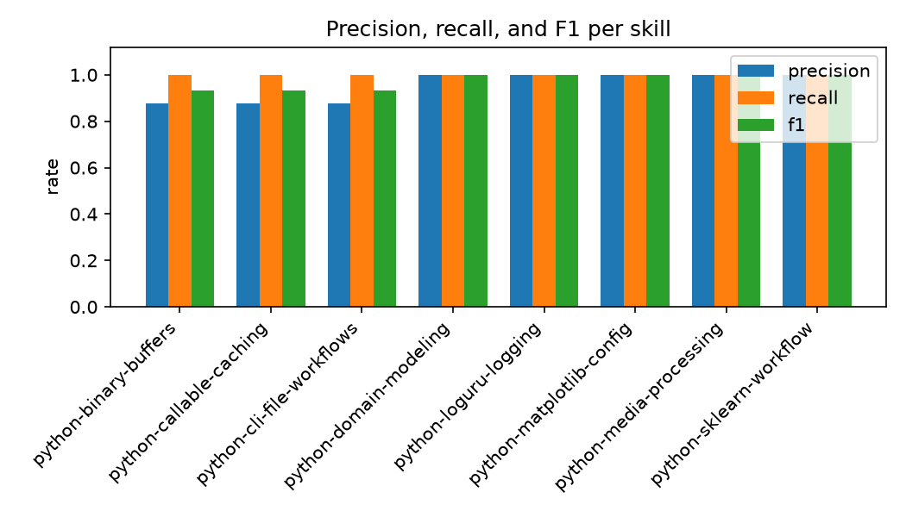
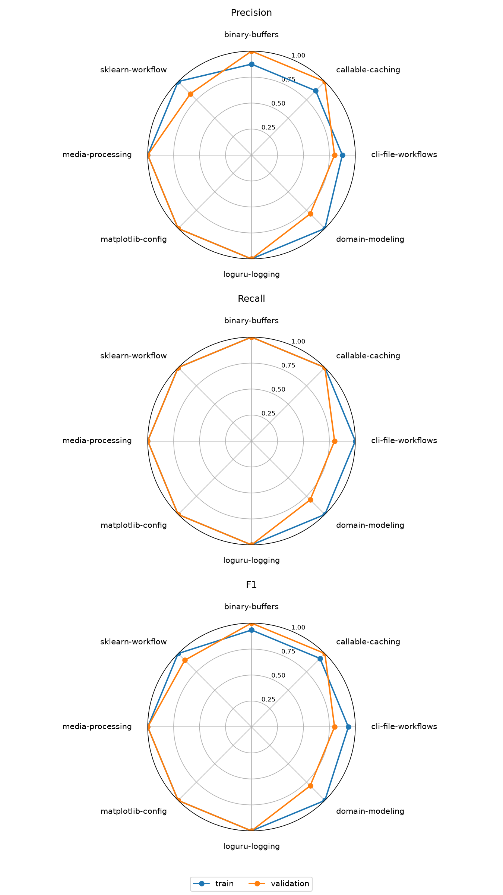

# python-engineering-skills

[English](README.md) | [中文](README_zh.md)

[](CHANGELOG.md)
[](https://github.com/autentisitet/python-engineering-skills/actions/workflows/ci.yml)
[](https://developers.openai.com/codex/skills/)
[](https://platform.claude.com/docs/en/agents-and-tools/agent-skills/overview)
[](https://platform.claude.com/docs/en/agents-and-tools/agent-skills/best-practices#evaluation-and-iteration)

Codex skills for medium and large Python repositories. They turn recurring engineering decisions
into reusable review criteria, improve the reliability of Agent-generated changes, and aim to
substantially reduce the mental load of programmer code review.

## Skills

| Skill | Purpose |
| --- | --- |
| [python-domain-modeling](skills/python-domain-modeling/SKILL.md) | Python typing, dataclasses, Pydantic/settings, interfaces, invariants, and model copy semantics |
| [python-callable-caching](skills/python-callable-caching/SKILL.md) | Callable placement, properties, closures, caches, construction hooks, and resource cleanup |
| [python-sklearn-workflow](skills/python-sklearn-workflow/SKILL.md) | Leakage-safe splits, CV, preprocessing, search, diagnostic curves, PCA, and inspection |
| [python-cli-file-workflows](skills/python-cli-file-workflows/SKILL.md) | Streaming file CLIs, path ownership, tqdm output, and argparse contracts |
| [python-matplotlib-config](skills/python-matplotlib-config/SKILL.md) | Global style, CJK font fallback, `.mplstyle`, and Axes-first plotting calls |
| [python-loguru-logging](skills/python-loguru-logging/SKILL.md) | Exception boundaries, bound context, file lifecycle, queued logging, and shutdown |
| [python-media-processing](skills/python-media-processing/SKILL.md) | OpenCV/Pillow/Decord/PyAV configuration, library selection, sampling, and color spaces |
| [python-binary-buffers](skills/python-binary-buffers/SKILL.md) | `bytes`, `bytearray`, `memoryview`, binary protocols, ownership, and incremental I/O |

After installation, invoke a skill explicitly with names such as `$python-domain-modeling`, or let
its description auto-match a relevant task.

---

## Installation

Keep this repository as the versioned source and link only the required skills into a trusted
target project's `.agents/skills/` directory.

### Linux and WSL

```bash
make install TARGET=/path/to/python-project
```

The shell scripts require Bash 4+ and GNU `find`/`readlink`.

### Windows PowerShell

```powershell
$TargetProject = Join-Path $HOME "src\python-project"
.\scripts\links\use-skills.ps1 `
  -Target $TargetProject `
  -Skills python-domain-modeling,python-sklearn-workflow
```

PowerShell creates directory junctions. The source repository and target project must remain on
accessible local paths.

Remove managed links with:

```bash
make remove TARGET=/path/to/python-project
```

```powershell
.\scripts\links\remove-skills.ps1 -Target $TargetProject
```

The removal scripts preserve ordinary directories and links not managed by this repository.

---

## Updating

Symlink and junction installs use this repository as their live source. Pull or otherwise update the
repository, review the changes, and start a new agent session in the target project.

```bash
git pull
make validate
```

---

## Structure

```text
python-engineering-skills/
├── evals/
│   ├── README.md                # dataset schema, categories, and eval workflow
│   ├── train_queries.json
│   ├── validation_queries.json
│   └── results/                 # generated locally; ignored by Git
├── scripts/
│   ├── evals/                   # discovery, activation, and dataset validation
│   ├── links/                   # project-scoped install/remove helpers
│   └── packages/                # skill package linter
├── skills/
│   └── <skill-name>/
│       ├── SKILL.md
│       ├── agents/openai.yaml
│       └── references/
└── tests/
```

---

## Validation

Use Python 3.12+:

```bash
uv sync --link-mode copy
uv run make validate
```

`requirements.txt` is a hash-verified export of `uv.lock`, and CI checks that they stay synchronized.
With pip:

```bash
python3 -m venv .venv
.venv/bin/python -m pip install --require-hashes -r requirements.txt
make validate PYTHON=.venv/bin/python
```

The Make targets provide the project's common commands:

| Command | Purpose |
| --- | --- |
| `make install TARGET=/path/to/project` | Install skills into a project |
| `make remove TARGET=/path/to/project` | Remove installed skills from a project |
| `make validate` | Validate skill packages, datasets, and tests offline |
| `make eval` | Run validation and, if Codex is installed, model-free skill discovery |
| `make smoke` | Run one positive and one negative model-backed case per skill in the training split |
| `make queries-csv` / `make queries-json` | Convert query sets between JSON and Excel-friendly CSV |
| `make queries-check` / `make queries-checksum` | Check JSON/CSV agreement or print their SHA-256 digests |
| `make retry-dataset` | Extract retry cases from a saved result; does not call a model |
| `make cross-check CROSS_MODEL=<model>` | Re-run baseline errors under another model |

`make smoke` and `make cross-check` call a model and consume tokens. Model-backed evals use the
caller's existing Codex configuration and login, with an environment allowlist for the CLI
process. They do not copy login files into the repository. See
[evals/README.md](evals/README.md) for the full runner contract.

The `make` and `.sh` commands require Bash 4+ with GNU `find`/`readlink`. On native Windows, use the
PowerShell installers and run these checks after installing dependencies:

```powershell
python -m scripts.packages.lint_skill_packages --strict-warnings
python -m scripts.evals.validate_evals
python -m unittest discover -s tests -p "test_*.py"
```

CI covers both Ubuntu and Windows.

---

## Evaluation

`evals/train_queries.json` and `evals/validation_queries.json` contain 176 positive and negative
routing cases across the eight skills, split about 60/40:

- training: 104 cases, with 7 positive and 6 negative cases per skill;
- validation: 72 held-out cases, with 5 positive and 4 negative cases per skill.

Each query carries a `category` (`direct`, `indirect`, `embedded`, or `boundary`) recording
whether it names the skill's API directly, describes it indirectly, embeds it in a larger task, or
sits just outside the skill's boundary. See `evals/README.md` for the dataset schema.

Validate the datasets without a model call:

```bash
python3 -m scripts.evals.validate_evals
```

For review in Excel, each JSON query set has a sibling CSV (`evals/*_queries.csv`) with the columns
`id,skill,category,query,should_trigger` and a UTF-8 BOM. Regenerate the CSVs from JSON, or convert
edited CSVs back into JSON, with:

```bash
# JSON -> CSV: escape formula-like cells and leading apostrophes so Excel cannot execute queries.
make queries-csv
# CSV -> JSON: restore text; replace JSON only when its SHA-256 changes after a temporary write.
make queries-json
# Print JSON/CSV SHA-256 digests to check drift; Git history tracks changes, not these digests.
make queries-checksum
```

The raw commands are:

```bash
python3 -m scripts.evals.convert_queries to-csv \
  evals/train_queries.json evals/train_queries.csv
python3 -m scripts.evals.convert_queries to-json \
  evals/train_queries.csv evals/train_queries.json \
  --split train --split-seed 20261112
```

Check actual Codex discovery without a model call:

```bash
python3 -m scripts.evals.check_skill_discovery \
  --output evals/results/discovery.json
```

Run observable activation trials through Codex only after accepting model cost and data transmission:

```bash
python3 -m scripts.evals.run_activation_evals evals/train_queries.json \
  --reasoning-effort low \
  --allow-model-calls \
  --output evals/results/activation-train.json
```

The runner launches a fresh `codex exec` process per trial and disables sub-agents within each
session. It uses your existing Codex login; see [evals/README.md](evals/README.md) for authentication,
isolation, and resume details.

Artifact quality is evaluated separately from routing; no model-backed quality baseline exists yet:

- [Acceptance samples](evals/artifact-samples.md): fixtures, verbatim prompts, and
  pass/fail criteria for each skill.
- [Temporary workspace workflow](evals/artifact-samples.md#isolated-working-directory):
  copy the target skill into a system temporary directory and run the task and checks there,
  without linking back to this repository.
- [Review and publication](evals/README.md#artifact-quality): inspect the artifact, verification
  output, and run conditions; publish scrubbed evidence using the
  [report template](evals/artifact-reviews/TEMPLATE.md). Keep raw logs out of Git.

For a cheaper behavior smoke test, set `--sample-per-label N` to run at most `N` positive and `N`
negative cases per skill. Values larger than the available cases use every available case without
repetition; zero, negative, and non-integer values are rejected.

### Routing Metrics (Historical Data)

Base model: `deepseek-flash` (low reasoning); Codex CLI: `codex-cli 0.167.0`. The evaluated
query set contains 104 train and 72 validation cases; its SHA-256 digests
match the current repository JSON, as does the skill digest. Due to token costs, this query set
has not been rerun in full under the current runtime conditions. These metrics measure skill reads,
not output quality; see [evals/README.md](evals/README.md) for the measurement method.

Local validation status:

- `make validate`: 8 skill packages clean, datasets valid, 132 tests passed.
- Skill discovery found all 8 packages.

Routing metrics (rounded to 4 decimal places):

| Metric | Train | Validation |
| --- | ---: | ---: |
| Precision | 0.9492 | 0.9268 |
| Recall | 1.0000 | 0.9500 |
| F1 | 0.9739 | 0.9383 |
| Accuracy | 0.9712 | 0.9306 |
| FPR | 0.0625 | 0.0938 |
| FNR | 0.0000 | 0.0500 |
| Infra. inconclusive rate | 0.0000 | 0.0000 |

In validation, two completed positive trials did not read the target skill and count as false
negatives, not infrastructure failures. Train false positives include one boundary case each in
`python-binary-buffers`, `python-callable-caching`, and `python-cli-file-workflows`.

### Metrics and statistical calibers

Every trial is one independent `codex exec --ephemeral` turn. A positive case should read the
target skill; a negative case should not.

| Cell | Definition |
| --- | --- |
| TP | positive case, target skill read (`pass`) |
| FN | positive case with a completed turn and no skill read (`fail`), or a positive `inconclusive` without an infrastructure failure |
| FP | negative case where the target skill was read (`fail`) |
| TN | negative case where the target skill was not read (`pass`) |
| Inconclusive | infrastructure failure (`timeout`, `agent_process_failed`, `completion_event_missing`, `evaluation_unavailable`) |

Derived metrics, rounded to 4 decimal places:

$$
\begin{aligned}
P &= \frac{TP}{TP+FP} \\
R &= \frac{TP}{TP+FN} \\
\mathrm{Specificity} &= \frac{TN}{TN+FP} \\
\mathrm{FPR} &= \frac{FP}{FP+TN} \\
\mathrm{FNR} &= \frac{FN}{FN+TP} \\
\mathrm{Accuracy} &= \frac{TP+TN}{TP+FN+FP+TN} \\
\mathrm{BalancedAccuracy} &= \frac{R+\mathrm{Specificity}}{2} \\
F_1 &= \frac{2PR}{P+R} \\
\mathrm{InconclusiveRate} &= \frac{N_{\mathrm{inconclusive}}}{N_{\mathrm{total}}} \\
\mathrm{Coverage} &= \frac{TP+FN+FP+TN}{N_{\mathrm{total}}}
\end{aligned}
$$

Inconclusive trials do not enter the routing metric denominators. See
[evals/README.md](evals/README.md) for query-level metrics and infrastructure diagnostics.

The harness observes only the binary event “target skill read or not read”; it does not expose a
continuous calibrated routing score. PR/ROC curves, AP, and ROC-AUC are therefore not valid for
these results.

### Cross-checking with a different model

To tell whether a baseline's failures/misses are weak-model noise, `cross_check_evals` re-runs
only the baseline error cases (the default) or the whole dataset (`--all-cases`) under another
model and reports which errors disappear, persist, or are newly introduced. The model is passed
in, never hardcoded. For a comparison under known runtime conditions, first produce a baseline
with the intended model and current validation JSON:

```bash
python3 -m scripts.evals.run_activation_evals evals/validation_queries.json \
  --model deepseek-flash --reasoning-effort low --allow-model-calls \
  --output evals/results/activation-validation-current.json
# Replace --model with any available model; --profile also works.
# Defaults to baseline errors; --all-cases also detects new errors across the full dataset.
# --json reports resolved/persisted/unresolved/introduced as machine-readable output.
python3 -m scripts.evals.cross_check_evals \
  --baseline evals/results/activation-validation-current.json \
  --dataset evals/validation_queries.json \
  --model deepseek-v4-pro --reasoning-effort low \
  --allow-model-calls \
  --output evals/results/activation-validation-v4pro.json
# Validation shortcut: make cross-check CROSS_MODEL=deepseek-v4-pro
```

### Summarize and Plot

Derive routing metrics deterministically from a result file:

```bash
python3 -m scripts.evals.summarize_evals evals/results/activation-train.json
python3 -m scripts.evals.summarize_evals evals/results/activation-train.json --json
```

The summary reports routing metrics and result freshness. Matplotlib charts can be generated locally:

```bash
uv run python -m scripts.evals.plot_evals \
  evals/results/activation-train.json \
  evals/results/activation-validation.json \
  --output-dir evals/results
```

### Routing Visualizations (Historical Data)

These charts use the same results as the historical metrics table above:



Confusion matrices: train (104 trials) on the left, validation (72 trials) on the right. Counts are separate for each split.



Per-skill comparison: train on the left, validation on the right. Each row is one skill; cells show the score and numerator/denominator.



The per-skill bar chart shows train results only.



Radar panels, top to bottom: precision, recall, F1. Blue is train; orange is validation.

---

## Design Conventions

- **Repeated decisions only.** A skill must repeatedly change implementation or review decisions;
  generic Python knowledge stays out.
- **Narrow routing.** Descriptions identify applicable work and adjacent exclusions; an incidental
  keyword does not justify loading a skill.
- **Progressive disclosure.** `SKILL.md` contains shared constraints and routing; conditional detail
  belongs in directly linked references.
- **Deterministic scripts only.** Add per-skill scripts only when repeated executable logic provides
  a clear reliability or token-cost benefit.
- **Platform layers stay separate.** `agents/openai.yaml` is optional Codex metadata, not a portable
  Agent Skills requirement.
- **Permissions remain external.** A skill can recommend a tool or script but cannot grant workspace,
  network, or execution permission.
- **Results have explicit limits.** Structure checks, routing observations, and artifact correctness
  are reported separately.

---

## License

This project is licensed under the [MIT License](LICENSE).
