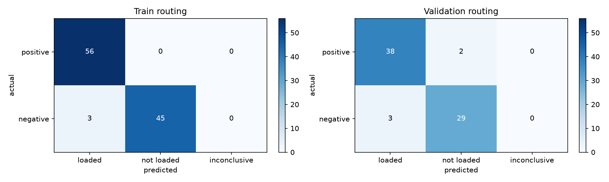
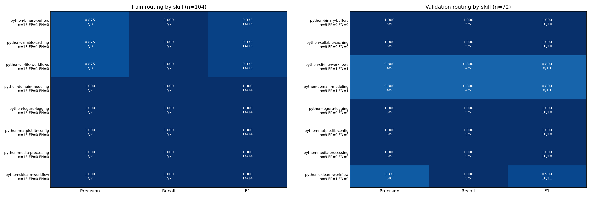
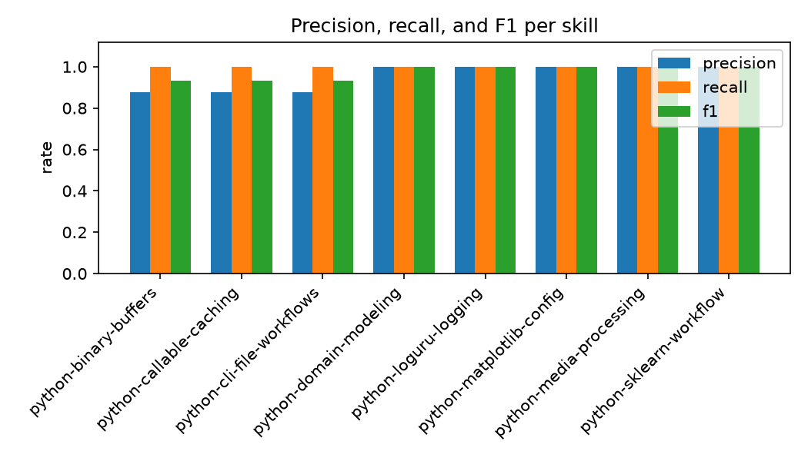
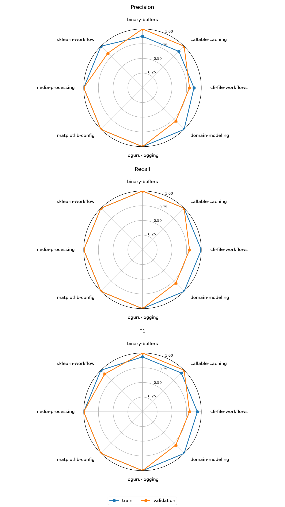

# python-engineering-skills

[English](README.md) | [中文](README_zh.md)

[](CHANGELOG.md)
[](https://github.com/autentisitet/python-engineering-skills/actions/workflows/ci.yml)
[](https://developers.openai.com/codex/skills/)
[](https://platform.claude.com/docs/en/agents-and-tools/agent-skills/overview)
[](https://platform.claude.com/docs/en/agents-and-tools/agent-skills/best-practices#evaluation-and-iteration)

一组面向中大型 Python 仓库的 Codex skills。它们将重复出现的工程决策转化为可复用的审查标准，
提高 Agent 代码修改的可靠性，并力图显著降低程序员 code review 的心智负担。

## Skills

| Skill | 用途 |
| --- | --- |
| [python-domain-modeling](skills/python-domain-modeling/SKILL.md) | Python 类型、dataclass、Pydantic/settings、接口、不变量和模型拷贝语义 |
| [python-callable-caching](skills/python-callable-caching/SKILL.md) | 可调用对象归属、property、闭包、缓存、构造钩子和资源清理 |
| [python-sklearn-workflow](skills/python-sklearn-workflow/SKILL.md) | 防泄漏的数据划分、CV、预处理、搜索、诊断曲线、PCA 和 inspection |
| [python-cli-file-workflows](skills/python-cli-file-workflows/SKILL.md) | 流式文件 CLI、路径所有权、tqdm 输出和 argparse 契约 |
| [python-matplotlib-config](skills/python-matplotlib-config/SKILL.md) | 全局样式、中文字体回退、`.mplstyle` 和 Axes 优先调用 |
| [python-loguru-logging](skills/python-loguru-logging/SKILL.md) | 异常边界、上下文绑定、文件生命周期、队列日志和退出等待 |
| [python-media-processing](skills/python-media-processing/SKILL.md) | OpenCV/Pillow/Decord/PyAV 配置、库选择、抽帧和颜色空间 |
| [python-binary-buffers](skills/python-binary-buffers/SKILL.md) | `bytes`、`bytearray`、`memoryview`、二进制协议、所有权和增量 I/O |

安装后可以通过 `$python-domain-modeling` 等名称显式调用，也可以由 description 自动匹配相关任务。

---

## 安装

将本仓库作为版本化源，只把需要的 skills 链接到受信任目标项目的 `.agents/skills/`。

### Linux 与 WSL

```bash
make install TARGET=/path/to/python-project
```

Shell 脚本需要 Bash 4+ 和 GNU `find`/`readlink`。

### Windows PowerShell

```powershell
$TargetProject = Join-Path $HOME "src\python-project"
.\scripts\links\use-skills.ps1 `
  -Target $TargetProject `
  -Skills python-domain-modeling,python-sklearn-workflow
```

PowerShell 默认创建目录 Junction，源仓库和目标项目必须保留在 Windows 可访问的本地路径中。

移除受本仓库管理的链接：

```bash
make remove TARGET=/path/to/python-project
```

```powershell
.\scripts\links\remove-skills.ps1 -Target $TargetProject
```

移除脚本会保留普通目录以及不由本仓库管理的链接。

---

## 更新

符号链接和 Junction 安装会直接使用本仓库作为源。更新仓库后先审查修改、运行验证，再在目标项目中
开启新的 Agent 会话。

```bash
git pull
make validate
```

---

## 目录

```text
python-engineering-skills/
├── evals/
│   ├── README.md                # 数据集结构、category 语义与流程
│   ├── train_queries.json
│   ├── validation_queries.json
│   └── results/                 # 本地生成，Git 忽略
├── scripts/
│   ├── evals/                   # 发现、真实激活和数据集验证
│   ├── links/                   # 项目级安装/移除工具
│   └── packages/                # skill package linter
├── skills/
│   └── <skill-name>/
│       ├── SKILL.md
│       ├── agents/openai.yaml
│       └── references/
└── tests/
```

---

## 验证

使用 Python 3.12+：

```bash
uv sync --link-mode copy
uv run make validate
```

`requirements.txt` 是 `uv.lock` 的带哈希导出，CI 会检查两者同步。使用 pip 时：

```bash
python3 -m venv .venv
.venv/bin/python -m pip install --require-hashes -r requirements.txt
make validate PYTHON=.venv/bin/python
```

Make 目标提供常用项目命令：

| 命令 | 用途 |
| --- | --- |
| `make install TARGET=/path/to/project` | 在目标项目中安装技能 |
| `make remove TARGET=/path/to/project` | 从目标项目卸载技能 |
| `make validate` | 离线校验技能包、数据集和测试 |
| `make eval` | 运行校验；已安装 Codex 时再做不调用模型的 skill 发现检查 |
| `make smoke` | 在训练集中为每个 skill 各运行一条正例和负例，调用模型 |
| `make queries-csv` / `make queries-json` | 在 JSON 与适合 Excel 审阅的 CSV 之间转换查询集 |
| `make queries-check` / `make queries-checksum` | 检查 JSON/CSV 一致性，或打印 SHA-256 摘要 |
| `make retry-dataset` | 从已保存结果提取重试案例，不调用模型 |
| `make cross-check CROSS_MODEL=<model>` | 用另一个模型重跑基线错误案例 |

`make smoke` 和 `make cross-check` 会调用模型并消耗额度。模型评测使用调用者现有的 Codex
配置和登录，并对传入 CLI 进程的环境变量使用白名单；不会把登录文件复制到仓库。完整参数见
[evals/README.md](evals/README.md)。

`make` 和 `.sh` 脚本需要 Bash 4+ 与 GNU `find`/`readlink`。原生 Windows 请使用 PowerShell
安装脚本，并在安装依赖后直接运行：

```powershell
python -m scripts.packages.lint_skill_packages --strict-warnings
python -m scripts.evals.validate_evals
python -m unittest discover -s tests -p "test_*.py"
```

CI 同时覆盖 Ubuntu 和 Windows。

---

## 评测

`evals/train_queries.json` 和 `evals/validation_queries.json` 包含 8 个 skills 的 176 条正负路由案例，
按约 60/40 划分：

- 训练集：104 条，每个 skill 7 条正例、6 条负例；
- 验证集：72 条 held-out 案例，每个 skill 5 条正例、4 条负例。

每条案例都带一个 `category`（`direct`、`indirect`、`embedded` 或 `boundary`），用于记录该请求是
直接点名技能 API、间接描述、嵌入更大任务，还是刚好落在技能边界之外。数据集结构见
`evals/README.md`。

不调用模型即可检查数据集：

```bash
python3 -m scripts.evals.validate_evals
```

为方便在 Excel 中审查，每个 JSON 查询集都有一个同级 CSV（`evals/*_queries.csv`），列为
`id,skill,category,query,should_trigger`，并带 UTF-8 BOM。从 JSON 重新生成 CSV，或把编辑后的
CSV 转回 JSON：

```bash
# JSON -> CSV：转义类似公式的单元格及前导单引号，避免 Excel 执行查询文本。
make queries-csv
# CSV -> JSON：还原文本；先写临时文件，仅在 SHA-256 变化时替换 JSON。
make queries-json
# 打印 JSON/CSV 的 SHA-256 以检查漂移；不提交摘要，变更由 Git 历史追踪。
make queries-checksum
```

底层命令是：

```bash
python3 -m scripts.evals.convert_queries to-csv \
  evals/train_queries.json evals/train_queries.csv
python3 -m scripts.evals.convert_queries to-json \
  evals/train_queries.csv evals/train_queries.json \
  --split train --split-seed 20261112
```

不调用模型即可检查 Codex 的实际发现结果：

```bash
python3 -m scripts.evals.check_skill_discovery \
  --output evals/results/discovery.json
```

接受模型费用和数据传输后，只通过 Codex 运行可观察的真实激活评测：

```bash
python3 -m scripts.evals.run_activation_evals evals/train_queries.json \
  --reasoning-effort low \
  --allow-model-calls \
  --output evals/results/activation-train.json
```

每条 trial 都会新启动一个 `codex exec` 进程，并禁用会话内的子代理。它使用现有 Codex 登录；
认证、隔离与断点续跑的细节见 [evals/README.md](evals/README.md)。

产物质量单独验收，目前没有模型实测基线：

- [验收样本](evals/artifact-samples.md)：每个 skill 的 fixture、原样 prompt 和通过/失败条件。
- [临时工作区流程](evals/artifact-samples.md#isolated-working-directory)：在系统临时目录复制目标 skill，
  运行任务与检查，不链接回本仓库。
- [结果整理与发布](evals/README.md#artifact-quality)：人工复核产物、验证输出和运行条件，
  按[报告模板](evals/artifact-reviews/TEMPLATE.md)提交脱敏证据；原始日志不纳入 Git。

想降低行为 smoke 测试成本时，可以设置 `--sample-per-label N`，使每个 skill 最多运行 `N` 条正例和
`N` 条负例。数值超过现有案例数时只会使用全部可用案例，不会重复；零、负数和非整数会被拒绝。

### 路由指标（历史数据）

基模为 `deepseek-flash`（低推理档）；Codex CLI 为 `codex-cli 0.167.0`。使用的 query set
包含训练集 104 条、验证集 72 条，其 SHA-256 与仓库内现有 JSON 相同，技能包摘要也匹配。
出于 token 成本考虑，尚未在当前运行条件下对该 query set 重新执行全量评测。
这些指标衡量 skill 是否被读取，不代表产物质量；测量方法见 [evals/README.md](evals/README.md)。

本地校验状态：

- `make validate`：8 个 skill 包 0 error / 0 warning，数据集校验通过，132 个测试全部通过。
- 技能发现检查找到全部 8 个包。

路由指标（保留 4 位小数）：

| 指标 | 训练集 | 验证集 |
| --- | ---: | ---: |
| Precision | 0.9492 | 0.9268 |
| Recall | 1.0000 | 0.9500 |
| F1 | 0.9739 | 0.9383 |
| Accuracy | 0.9712 | 0.9306 |
| FPR | 0.0625 | 0.0938 |
| FNR | 0.0000 | 0.0500 |
| 基础设施不可判定率 | 0.0000 | 0.0000 |

验证集中 2 条已完成的正例未读取目标 skill，计入 FN，而非基础设施故障。
训练集的误触发包括 `python-binary-buffers`、`python-callable-caching`、`python-cli-file-workflows`
各 1 条 boundary 负例。

### 统计口径

每条 trial 都是一次独立的 `codex exec --ephemeral` turn。正例应当读到目标 skill，负例不应当。

| 单元 | 定义 |
| --- | --- |
| TP | 正例，读到目标 skill（`pass`） |
| FN | 正例，turn 完成但没读到 skill（`fail`），或没有基础设施故障的 `inconclusive` |
| FP | 负例，却读到了 skill（`fail`） |
| TN | 负例，没读到 skill（`pass`） |
| Inconclusive | 基础设施故障（`timeout`、`agent_process_failed`、`completion_event_missing`、`evaluation_unavailable`） |

指标统一保留 4 位小数：

$$
\begin{aligned}
P &= \frac{TP}{TP+FP} \\
R &= \frac{TP}{TP+FN} \\
\mathrm{Specificity} &= \frac{TN}{TN+FP} \\
\mathrm{FPR} &= \frac{FP}{FP+TN} \\
\mathrm{FNR} &= \frac{FN}{FN+TP} \\
\mathrm{Accuracy} &= \frac{TP+TN}{TP+FN+FP+TN} \\
\mathrm{BalancedAccuracy} &= \frac{R+\mathrm{Specificity}}{2} \\
F_1 &= \frac{2PR}{P+R} \\
\mathrm{InconclusiveRate} &= \frac{N_{\mathrm{inconclusive}}}{N_{\mathrm{total}}} \\
\mathrm{Coverage} &= \frac{TP+FN+FP+TN}{N_{\mathrm{total}}}
\end{aligned}
$$

Inconclusive 不进入路由指标分母。单条 query 指标和基础设施诊断的口径见
[evals/README.md](evals/README.md)。

当前 harness 只观察“是否读取目标 skill”这一离散事件，没有连续且经过校准的路由分数。因此这些
结果不适合计算 PR/ROC 曲线、AP 或 ROC-AUC。

### 换模型交叉验证

想知道基线里的失败/漏触发是不是弱模型噪声，可以用 `cross_check_evals` 用另一个模型只重跑
基线里的错误 case（默认）或整个数据集（`--all-cases`），并报告哪些错误消失、哪些仍在、
哪些新出现。模型通过参数传入，不写死。要在明确的运行条件下对比，先用目标模型和当前
验证集 JSON 生成基线：

```bash
python3 -m scripts.evals.run_activation_evals evals/validation_queries.json \
  --model deepseek-flash --reasoning-effort low --allow-model-calls \
  --output evals/results/activation-validation-current.json
# --model 可换成任何可用模型，也可以使用 --profile。
# 默认只重跑基线错误 case；--all-cases 跑完整数据集，也能发现新增错误。
# --json 以机器可读形式输出 resolved/persisted/unresolved/introduced 四类。
python3 -m scripts.evals.cross_check_evals \
  --baseline evals/results/activation-validation-current.json \
  --dataset evals/validation_queries.json \
  --model deepseek-v4-pro --reasoning-effort low \
  --allow-model-calls \
  --output evals/results/activation-validation-v4pro.json
# 验证集快捷方式：make cross-check CROSS_MODEL=deepseek-v4-pro
```

### 汇总与绘图

从结果文件确定性地推导路由指标：

```bash
python3 -m scripts.evals.summarize_evals evals/results/activation-train.json
python3 -m scripts.evals.summarize_evals evals/results/activation-train.json --json
```

汇总会输出路由指标与结果 freshness；本地可用 matplotlib 生成图表：

```bash
uv run python -m scripts.evals.plot_evals \
  evals/results/activation-train.json \
  evals/results/activation-validation.json \
  --output-dir evals/results
```

### 路由可视化（历史数据）

以下图表与上方历史指标表使用同一份结果：



混淆矩阵：左侧为训练集（104 条），右侧为验证集（72 条）；各面板的计数独立统计。



逐技能对照图：左侧为训练集，右侧为验证集；每行对应一个 skill，格内显示指标值及其分子/分母。



逐技能柱状图仅展示训练集。



雷达图从上到下依次为 Precision、Recall、F1；蓝线代表训练集，橙线代表验证集。

---

## 设计约定

- **只保留重复决策。** Skill 必须能反复改变实现或审查决策；通用 Python 知识不单独建 skill。
- **路由范围明确。** Description 同时说明适用工作与相邻排除项，偶然出现关键词不足以触发。
- **渐进披露。** `SKILL.md` 保存共用约束与路由，条件细节放在直接链接的 references。
- **只为确定性操作增加脚本。** 只有可重复执行逻辑能明显提高可靠性或降低 token 成本时，才增加
  skill 自带脚本。
- **区分平台层。** `agents/openai.yaml` 是可选 Codex 元数据，不是通用 Agent Skills 必需文件。
- **权限不随 skill 扩大。** Skill 可以推荐工具或脚本，但不能授予 workspace、网络或执行权限。
- **结果边界明确。** 结构检查、路由观察和最终产物正确性分别报告。

---

## License

本项目使用 [MIT License](LICENSE)。
